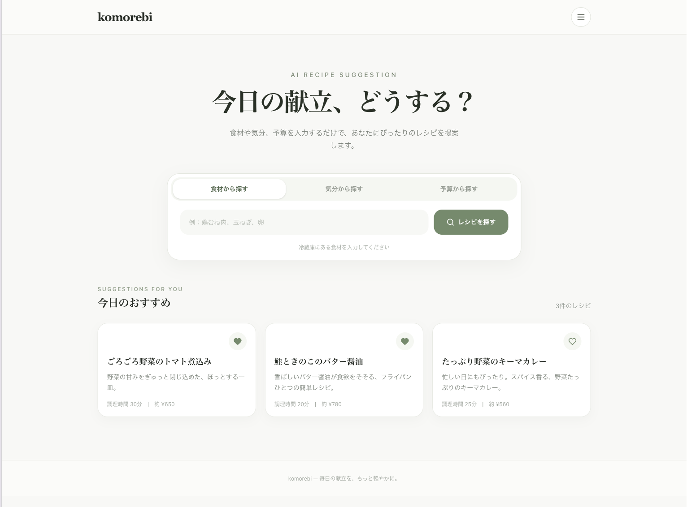
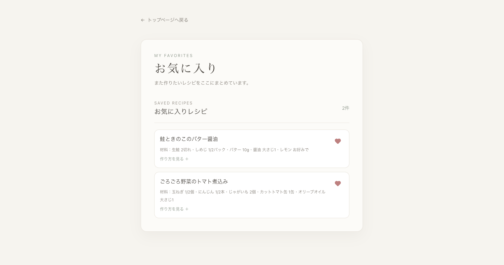
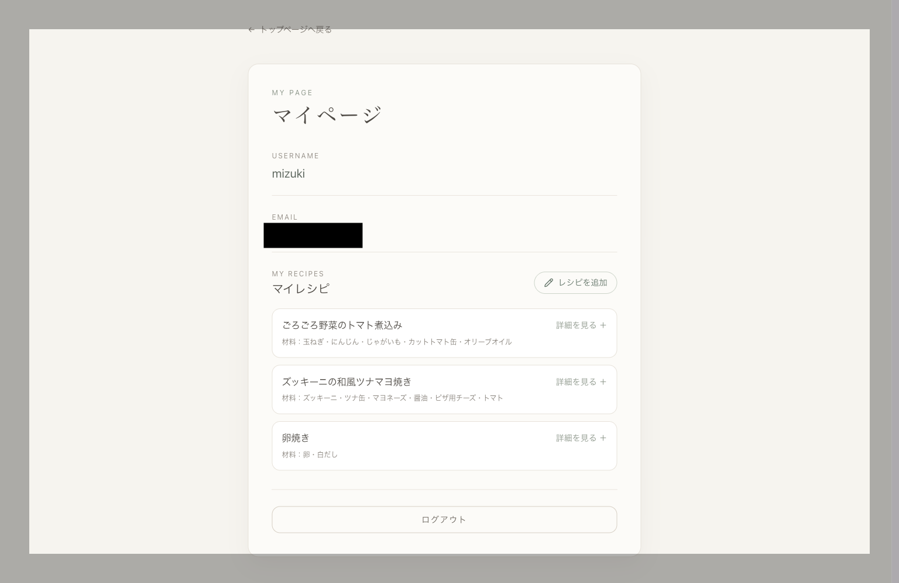
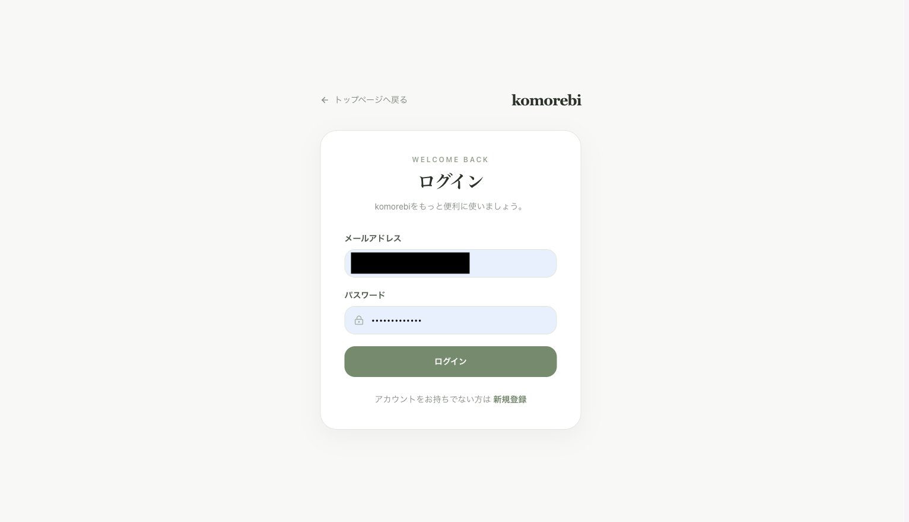
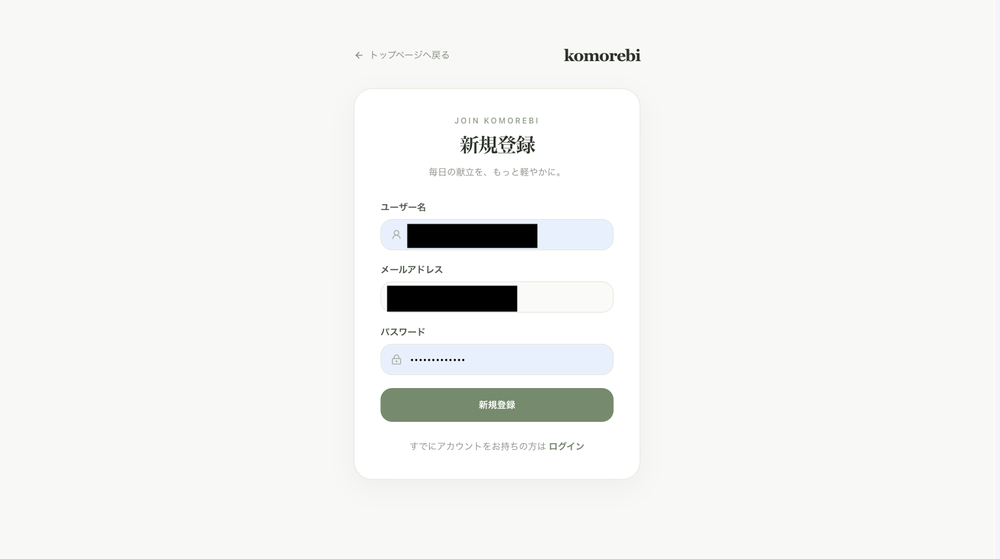
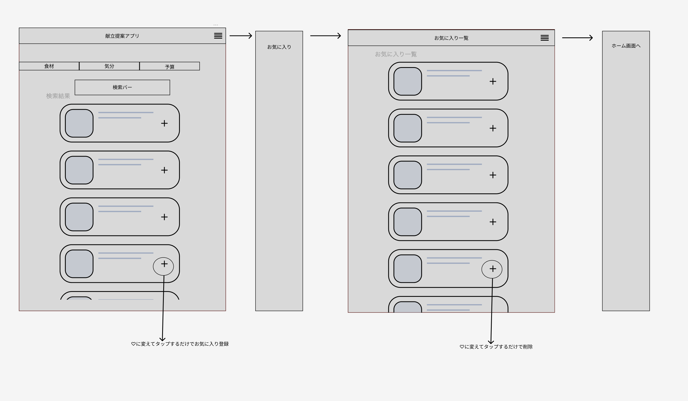
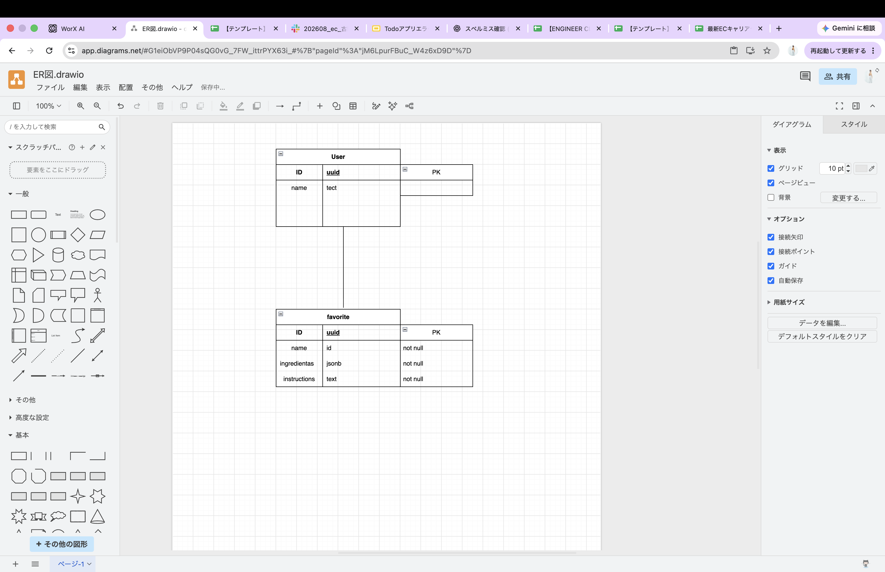

# portfolio
Nect.jsとSupaBaseを用いた献立提案アプリです
# サイトイメージ

# サイトURL
https://komorebi-app-zeta.vercel.app/
# 使用技術
・フロントエンド：Next.js 15.3
・バックエンド：Next.js 15.3
・データベース：Supabase,Gemini
・デプロイ：Vercel
・バージョン管理：Git、GitHub
# 設計ドキュメント
【要件定義・基本設計・詳細設計の一覧_Googleスプレッドシート】（https://docs.google.com/spreadsheets/d/1yY-tQQrNxQIPgIEYXIMMWD72GEaOyAaEXkoNX_iSq9U/edit?usp=sharing）
詳細設計時のワイヤーフレーム、ER図、の画像はDocsディレクトリに格納しています

# 機能一覧
ログイン機能
献立検索
・入力した食材での献立提案
・今の気分で献立提案
・予算ベースでの提案
上記はモーム画面からタブで変更可能
お気に入り登録
オリジナルレシピの新規作成、編集、削除、更新
# テスト・修正の設計及び実施書
URL
# アプリの改善案
URL
# 備考

